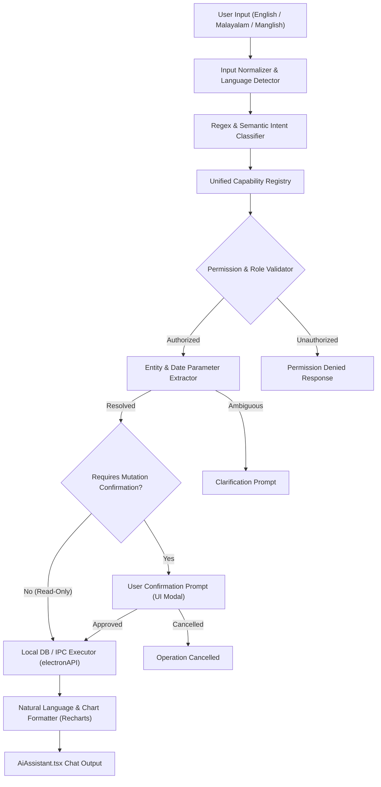

# Nafid POS — Offline AI Knowledge Integration & Capability Registry Design

**Application:** Nafid POS  
**Module:** Offline AI Business Assistant (`src/services/offlineAiService.ts`, `src/components/AiAssistant.tsx`)  
**Design Standard:** 100% Offline-First, Zero Cloud LLM Dependency, Real Implementation Reference, Deterministic Local Database Execution.  
**Deliverable File:** `docs/ai-knowledge/ai-integration-design.md`  

---

## 1. System Architecture: Offline AI Execution Pipeline

The AI Assistant in Nafid POS is designed around a deterministic, natural-language-to-SQL/IPC translation engine. It does not send store financial records or customer data to external LLMs. Instead, it operates entirely within the local Electron process using a structured, searchable **Capability Registry**.



---

## 2. Structured Capability Registry Schema

The capability registry represents every verified page action in Nafid POS as a strongly typed TypeScript interface matching existing backend IPC channels.

```typescript
export type OperationType = 'READ_ONLY' | 'MUTATION_SAFE' | 'MUTATION_DESTRUCTIVE';

export interface CapabilityRegistryEntry {
  // Unique capability identifier
  id: string;
  // Module and page origin
  module: 'sales' | 'inventory' | 'cash_register' | 'parties' | 'purchases' | 'quotations' | 'returns' | 'scrap' | 'staff' | 'reports';
  pageName: string;
  sourceComponent: string;
  
  // Natural language intent patterns (English, Malayalam, Manglish)
  intentKey: string;
  patterns: {
    en: RegExp[];
    ml: RegExp[];
    manglish: RegExp[];
  };
  sampleQueries: {
    en: string[];
    ml: string[];
    manglish: string[];
  };

  // Execution specification
  operationType: OperationType;
  requiredPermission: string;
  confirmationRequired: boolean;
  confirmationTemplate?: (params: any) => { en: string; ml: string; manglish: string };

  // Data flow
  ipcChannel: string;
  dbOperation: string;
  requiredParameters: Array<{
    name: string;
    type: 'string' | 'number' | 'date_range' | 'customer_id' | 'invoice_id' | 'product_id';
    extractor: (text: string) => any;
    fallbackPrompt: string;
  }>;

  // Expected output schema
  outputType: 'METRIC_CARD' | 'TABLE' | 'BAR_CHART' | 'AREA_CHART' | 'PIE_CHART' | 'TEXT_STATUS';
  formatter: (data: any, isMal: boolean) => { content: string; chartData?: any };
}
```

---

## 3. Core Capability Registry Implementation

Below is the verified registry mapping covering primary modules:

### A. Sales & History Module

```typescript
export const SALES_CAPABILITY_REGISTRY: CapabilityRegistryEntry[] = [
  {
    id: 'SALES_TODAY',
    module: 'sales',
    pageName: 'Sales History / Billing',
    sourceComponent: 'src/components/SalesHistory.tsx',
    intentKey: 'SALES_TODAY',
    patterns: {
      en: [/today('s)? sales/i, /sales (today|so far)/i, /how much did we sell today/i],
      ml: [/ഇന്നത്തെ (സെയിൽസ്|കച്ചവടം|വിൽപന)/i, /ഇന്ന് എത്ര (വിറ്റു|കിട്ടി|ആയി)/i],
      manglish: [/innathe (sales|kachavadam|vilppana)/i, /innu ethra (aayi|kitti|vittu)/i]
    },
    sampleQueries: {
      en: ["What is today's sales total?", "How much did we sell today?"],
      ml: ["ഇന്നത്തെ ആകെ സെയിൽസ് എത്രയാണ്?", "ഇന്ന് എത്ര കച്ചവടം നടന്നു?"],
      manglish: ["Innathe sales ethraya?", "Innu ethra kachavadam nadannu?"]
    },
    operationType: 'READ_ONLY',
    requiredPermission: 'sales.view',
    confirmationRequired: false,
    ipcChannel: 'db:getInvoicesSummary',
    dbOperation: 'SELECT SUM(grand_total), SUM(tax_total), COUNT(*) FROM invoices WHERE ...',
    requiredParameters: [
      {
        name: 'dateRange',
        type: 'date_range',
        extractor: () => resolveDateRange('today'),
        fallbackPrompt: 'Please specify the date.'
      }
    ],
    outputType: 'METRIC_CARD',
    formatter: (data, isMal) => ({
      content: isMal
        ? `ഇന്നത്തെ ആകെ സെയിൽസ്: **${formatINR(data.totalSales)}** (${data.invoiceCount} ബില്ലുകൾ).`
        : `Today's total sales: **${formatINR(data.totalSales)}** across ${data.invoiceCount} invoices.`
    })
  },

  {
    id: 'INVOICE_LOOKUP',
    module: 'sales',
    pageName: 'Sales History',
    sourceComponent: 'src/components/SalesHistory.tsx',
    intentKey: 'INVOICE_LOOKUP',
    patterns: {
      en: [/invoice (number|details|info) #?([A-Za-z0-9-]+)/i, /bill #?([A-Za-z0-9-]+)/i],
      ml: [/ബിൽ (വിവരങ്ങൾ|നമ്പർ) #?([A-Za-z0-9-]+)/i, /ഇൻവോയ്സ് #?([A-Za-z0-9-]+)/i],
      manglish: [/bill (details|number) #?([A-Za-z0-9-]+)/i, /invoice #?([A-Za-z0-9-]+)/i]
    },
    sampleQueries: {
      en: ["Show me invoice GST-0042", "Bill details 1045"],
      ml: ["GST-0042 ഇൻവോയ്സ് വിവരങ്ങൾ കാണിക്കൂ", "ബിൽ 1045 കാണിക്കുക"],
      manglish: ["Invoice GST-0042 details kaanicku", "Bill 1045 details"]
    },
    operationType: 'READ_ONLY',
    requiredPermission: 'sales.view',
    confirmationRequired: false,
    ipcChannel: 'db:getInvoices',
    dbOperation: 'SELECT * FROM invoices WHERE invoice_number = ?',
    requiredParameters: [
      {
        name: 'invoiceNumber',
        type: 'string',
        extractor: (text) => extractInvoiceNumber(text),
        fallbackPrompt: 'Which bill number would you like to inspect?'
      }
    ],
    outputType: 'TABLE',
    formatter: (inv, isMal) => ({
      content: isMal
        ? `ബിൽ: **${inv.invoice_number}** | കസ്റ്റമർ: **${inv.customer_name || 'Counter Customer'}** | തുക: **${formatINR(inv.grand_total)}** (${inv.payment_method}).`
        : `Bill: **${inv.invoice_number}** | Customer: **${inv.customer_name || 'Counter Customer'}** | Total: **${formatINR(inv.grand_total)}** (${inv.payment_method}).`
    })
  },

  {
    id: 'INVOICE_DELETE_MUTATION',
    module: 'sales',
    pageName: 'Sales History',
    sourceComponent: 'src/components/SalesHistory.tsx',
    intentKey: 'INVOICE_DELETE',
    patterns: {
      en: [/delete invoice #?([A-Za-z0-9-]+)/i, /void bill #?([A-Za-z0-9-]+)/i],
      ml: [/ബിൽ #?([A-Za-z0-9-]+) ഡിലീറ്റ് ചെയ്യുക/i, /ഇൻവോയ്സ് #?([A-Za-z0-9-]+) ഒഴിവാക്കുക/i],
      manglish: [/bill #?([A-Za-z0-9-]+) delete cheyyu/i, /invoice #?([A-Za-z0-9-]+) cancel aakku/i]
    },
    sampleQueries: {
      en: ["Delete invoice 1024", "Void bill GST-0012"],
      ml: ["ബിൽ 1024 ഡിലീറ്റ് ചെയ്യുക", "ഇൻവോയ്സ് GST-0012 ഒഴിവാക്കൂ"],
      manglish: ["Bill 1024 delete cheyyu", "Invoice GST-0012 void aakku"]
    },
    operationType: 'MUTATION_DESTRUCTIVE',
    requiredPermission: 'sales.delete',
    confirmationRequired: true,
    confirmationTemplate: (params) => ({
      en: `Are you sure you want to delete invoice **${params.invoiceNumber}**? This will restore stock items and reverse customer credit debt.`,
      ml: `ഇൻവോയ്സ് **${params.invoiceNumber}** ഡിലീറ്റ് ചെയ്യണമെന്ന് ഉറപ്പാണോ? ഇത് സ്റ്റോക്ക് പുനഃസ്ഥാപിക്കുകയും കസ്റ്റമർ ബാക്കി തുക റദ്ദാക്കുകയും ചെയ്യും.`,
      manglish: `Invoice **${params.invoiceNumber}** delete cheyyano? Ith stock restore cheyyukayum customer credit reverse cheyyukayum cheyyum.`
    }),
    ipcChannel: 'db:deleteInvoice',
    dbOperation: 'deleteInvoice(invoice_id) [Full stock restock, ledger reversal, cash reversal]',
    requiredParameters: [
      {
        name: 'invoiceNumber',
        type: 'string',
        extractor: (text) => extractInvoiceNumber(text),
        fallbackPrompt: 'Please specify the invoice number to delete.'
      }
    ],
    outputType: 'TEXT_STATUS',
    formatter: (result, isMal) => ({
      content: isMal
        ? `ഇൻവോയ്സ് വിജയകരമായി ഡിലീറ്റ് ചെയ്യുകയും സ്റ്റോക്ക് തിരിച്ചെടുക്കുകയും ചെയ്തു.`
        : `Invoice deleted successfully and inventory stock has been restored.`
    })
  }
];
```

---

### B. Inventory & Stock Module

```typescript
export const INVENTORY_CAPABILITY_REGISTRY: CapabilityRegistryEntry[] = [
  {
    id: 'INVENTORY_LOW_STOCK',
    module: 'inventory',
    pageName: 'Inventory Manager',
    sourceComponent: 'src/components/InventoryManager.tsx',
    intentKey: 'INVENTORY_LOW_STOCK',
    patterns: {
      en: [/low stock( items)?/i, /out of stock/i, /which items need reorder/i],
      ml: [/സ്റ്റോക്ക് കുറഞ്ഞ (സാധനങ്ങൾ|ഇനങ്ങൾ)/i, /തീരാറായ ഐറ്റങ്ങൾ/i],
      manglish: [/low stock items/i, /theeraaraya items/i, /stock kuranja items/i]
    },
    sampleQueries: {
      en: ["Show me low stock items", "Which products are out of stock?"],
      ml: ["സ്റ്റോക്ക് കുറഞ്ഞ സാധനങ്ങൾ കാണിക്കൂ", "തീരാറായ ഇനങ്ങൾ ഏതൊക്കെയാണ്?"],
      manglish: ["Low stock items kaanicku", "Theeraaraya items ethokkeyanu?"]
    },
    operationType: 'READ_ONLY',
    requiredPermission: 'products.view',
    confirmationRequired: false,
    ipcChannel: 'db:getProducts',
    dbOperation: 'SELECT * FROM products WHERE current_stock <= reorder_level AND is_deleted = 0',
    requiredParameters: [],
    outputType: 'TABLE',
    formatter: (items, isMal) => ({
      content: isMal
        ? `റീഓർഡർ ചെയ്യേണ്ട **${items.length}** സാധനങ്ങൾ കണ്ടെത്തി:`
        : `Found **${items.length}** products below their reorder threshold:`
    })
  },

  {
    id: 'STOCK_ADJUST_MUTATION',
    module: 'inventory',
    pageName: 'Inventory Manager',
    sourceComponent: 'src/components/InventoryManager.tsx',
    intentKey: 'STOCK_ADJUST',
    patterns: {
      en: [/adjust stock of (.+) by ([+-]?\d+)/i, /set stock of (.+) to (\d+)/i],
      ml: [/(.+) സ്റ്റോക്ക് (\d+) ആയി ക്രമീകരിക്കുക/i],
      manglish: [/(.+) stock (\d+) aakku/i, /adjust (.+) stock by ([+-]?\d+)/i]
    },
    sampleQueries: {
      en: ["Adjust stock of Cement 50kg by +10", "Set stock of Sugar 1kg to 45"],
      ml: ["സിമന്റ് 50kg സ്റ്റോക്ക് 10 കൂട്ടുക", "പഞ്ചസാര സ്റ്റോക്ക് 45 ആയി മാറ്റുക"],
      manglish: ["Cement 50kg stock +10 add cheyyu", "Sugar stock 45 aakki maattu"]
    },
    operationType: 'MUTATION_SAFE',
    requiredPermission: 'products.stock_adjust',
    confirmationRequired: true,
    confirmationTemplate: (params) => ({
      en: `Confirm adjusting stock for **${params.productName}** by **${params.delta}** units?`,
      ml: `**${params.productName}** സ്റ്റോക്ക് **${params.delta}** എണ്ണം മാറ്റാൻ ഉറപ്പാണോ?`,
      manglish: `**${params.productName}** stock **${params.delta}** change cheyyano?`
    }),
    ipcChannel: 'db:adjustStock',
    dbOperation: 'UPDATE products SET current_stock = current_stock + ? WHERE product_id = ?',
    requiredParameters: [
      {
        name: 'productName',
        type: 'string',
        extractor: (text) => extractProductName(text),
        fallbackPrompt: 'Which product stock should be adjusted?'
      },
      {
        name: 'delta',
        type: 'number',
        extractor: (text) => extractNumericDelta(text),
        fallbackPrompt: 'What quantity should be added or subtracted?'
      }
    ],
    outputType: 'TEXT_STATUS',
    formatter: (res, isMal) => ({
      content: isMal
        ? `സ്റ്റോക്ക് വിജയകരമായി പുതുക്കി.`
        : `Stock level updated successfully.`
    })
  }
];
```

---

### C. Cash Register & Till Module

```typescript
export const CASH_REGISTER_CAPABILITY_REGISTRY: CapabilityRegistryEntry[] = [
  {
    id: 'CASH_DRAWER_CURRENT',
    module: 'cash_register',
    pageName: 'Cashier Settlement',
    sourceComponent: 'src/components/CashierSettlement.tsx',
    intentKey: 'CASH_DRAWER_CURRENT',
    patterns: {
      en: [/cash in drawer/i, /till balance/i, /how much cash do we have right now/i],
      ml: [/ഡ്രോയറിലെ ക്യാഷ് എത്രയുണ്ട്/i, /പെട്ടിയിലെ പണം/i],
      manglish: [/drawerile cash ethrayundu/i, /pettiyile cash/i, /till balance ethraya/i]
    },
    sampleQueries: {
      en: ["How much cash is in the drawer right now?", "Current till balance?"],
      ml: ["ഡ്രോയറിൽ ഇപ്പോൾ എത്ര ക്യാഷ് ഉണ്ട്?", "പെട്ടിയിലെ ബാക്കി പണം എത്രയാണ്?"],
      manglish: ["Draweril ippol ethra cash undu?", "Current till balance ethraya?"]
    },
    operationType: 'READ_ONLY',
    requiredPermission: 'cash_register.view',
    confirmationRequired: false,
    ipcChannel: 'db:cashier:getDrawer',
    dbOperation: 'SELECT opening_balance, cash_sales, cash_in, cash_out FROM cash_drawer WHERE status = "OPEN"',
    requiredParameters: [],
    outputType: 'METRIC_CARD',
    formatter: (d, isMal) => ({
      content: isMal
        ? `ഇപ്പോഴത്തെ പ്രതീക്ഷിക്കുന്ന ക്യാഷ് ബാലൻസ്: **${formatINR(d.expectedCash)}** (ഓപ്പണിംഗ്: ${formatINR(d.opening_balance)}, സെയിൽസ്: ${formatINR(d.cash_sales)}).`
        : `Current expected cash in drawer: **${formatINR(d.expectedCash)}** (Opening: ${formatINR(d.opening_balance)}, Cash Sales: ${formatINR(d.cash_sales)}).`
    })
  },

  {
    id: 'RECORD_EXPENSE_MUTATION',
    module: 'cash_register',
    pageName: 'Cashier Settlement',
    sourceComponent: 'src/components/CashierSettlement.tsx',
    intentKey: 'RECORD_EXPENSE',
    patterns: {
      en: [/record expense of (\d+) for (.+)/i, /paid (\d+) for (.+)/i],
      ml: [/(.+) ഇനത്തിൽ (\d+) ചിലവ് രേഖപ്പെടുത്തുക/i],
      manglish: [/(.+) inathil (\d+) expense add cheyyu/i, /(\d+) roopa (.+) aayi koduthu/i]
    },
    sampleQueries: {
      en: ["Record expense of 150 for Tea and Snacks", "Paid 500 for Delivery courier"],
      ml: ["ചായക്ക് 150 രൂപ ചിലവ് രേഖപ്പെടുത്തുക", "കൊറിയർ ചാർജ് 500 കൊടുത്തു"],
      manglish: ["Tea snacks 150 expense add cheyyu", "Delivery 500 cash koduthu"]
    },
    operationType: 'MUTATION_SAFE',
    requiredPermission: 'cash_register.cash_out',
    confirmationRequired: true,
    confirmationTemplate: (params) => ({
      en: `Record a Cash Out expense of **${formatINR(params.amount)}** under category **${params.category}**?`,
      ml: `**${formatINR(params.amount)}** തുക **${params.category}** ചിലവായി രേഖപ്പെടുത്താൻ ഉറപ്പാണോ?`,
      manglish: `**${formatINR(params.amount)}** amount **${params.category}** expense aayi record cheyyano?`
    }),
    ipcChannel: 'db:cashier:addTransaction',
    dbOperation: 'INSERT INTO cash_transactions (type="CASH_OUT", amount=?, category=?, notes=?)',
    requiredParameters: [
      {
        name: 'amount',
        type: 'number',
        extractor: (text) => extractAmount(text),
        fallbackPrompt: 'Please specify the expense amount.'
      },
      {
        name: 'category',
        type: 'string',
        extractor: (text) => extractCategoryOrNotes(text),
        fallbackPrompt: 'What was this expense for?'
      }
    ],
    outputType: 'TEXT_STATUS',
    formatter: (res, isMal) => ({
      content: isMal
        ? `ചിലവ് രേഖപ്പെടുത്തി, ക്യാഷ് ഡ്രോയർ തുക പുതുക്കി.`
        : `Expense recorded and cash drawer reconciled.`
    })
  }
];
```

---

## 4. Entity Extraction & Normalization Engine

1. **Date Parameter Resolution:**
   - Detects relative time words (`today`, `yesterday`, `this week`, `last month`) and Malayalam equivalents (`ഇന്ന്`, `ഇന്നലെ`, `ഈ മാസം`, `കഴിഞ്ഞ ആഴ്ച`).
   - Resolves to standard ISO-8601 strings (`YYYY-MM-DD`) using the store's configured timezone via `getStoreTimezone()`.

2. **Invoice Number Normalizer:**
   - Strips hashtags, prefixes, and punctuation (e.g. `#GST-042`, `gst 042`, `Bill no 42` → clean regex match `GST-0042` or `042`).

3. **Customer & Product Entity Disambiguation:**
   - Runs SQLite `CLEAN_STR()` substring lookup.
   - If multiple candidates are found (e.g. 3 products named "Tata Tea"), the AI stops and presents an interactive clarification option pill to the user before continuing.

---

## 5. Security, Permission Guard & Mutation Policy

### Enforcement Rules:
1. **User Role & Permission Check:**
   - Every capability specifies its `requiredPermission` (e.g., `sales.delete`, `products.stock_adjust`).
   - The AI inspects `useAuthStore.getState()` and invokes `hasPermission({ role, permissions }, requiredPermission)`.
   - If unauthorized, execution halts immediately:
     *"You do not have permission to perform this action. Required permission: `sales.delete`."*

2. **Read-Only vs. Mutation Separation:**
   - **Read-Only:** Returns instant data analysis or rendered charts without confirmation.
   - **Mutations (Safe):** Adding expense, updating customer address, adjusting stock. Requires a clear confirmation prompt with summary parameters.
   - **Mutations (Destructive):** Deleting invoice, deleting customer, deleting product. Requires **Explicit Two-Step Confirmation** explaining the irreversible side effects (stock restock, ledger balance deletion, cashier reconciliation).

3. **Offline Isolation:**
   - Never makes external HTTP API calls for core queries.
   - All operations execute against local SQLite via Electron IPC.
   - Offline changes are automatically marked `sync_status = 'PENDING'` for background sync when network connectivity is restored.
