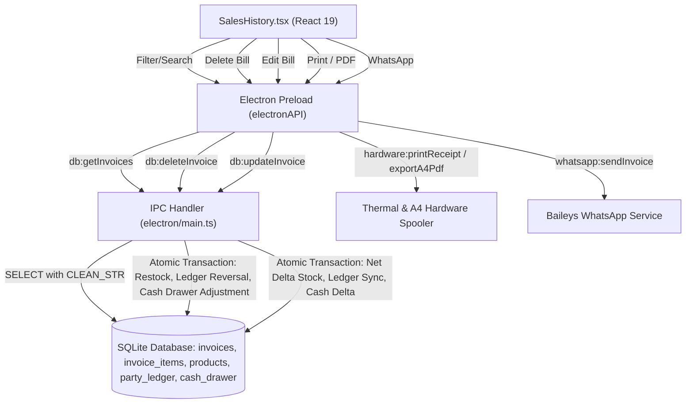

# Nafid POS — Sales History Capability Deep Dive & AI Knowledge Map

**Module / Page:** Sales History (`SalesHistory.tsx`)  
**Source Path:** [`src/components/SalesHistory.tsx`](file:///c:/EMIRATES%20WEBFUSION%20WORKS/nafid/nafid-pos/src/components/SalesHistory.tsx)  
**Parent Navigation:** Owner Dashboard Tile (`id: 'history'`) or Billing Page Header Quick Action  
**Permission Gate:** `<PermissionGuard permission="sales.view">`  
**Feature Flag:** `sales_history: true` in `useFeatureFlagsStore`  
**Database Backend:** SQLite (`better-sqlite3`) managed via Electron IPC in `electron/main.ts` and `electron/db/localDb.ts`  
**Deliverable File:** `docs/ai-knowledge/pages/sales-history.md`  

---

## 1. Page Architectural Overview

Sales History is the central audit, compliance, and transaction archive workspace in Nafid POS. It tracks every issued invoice across both legal fiscal regimes:
1. **GST Tax Invoices:** Formal tax documents with CGST, SGST, IGST tax breakdown, HSN/SAC codes, B2B/B2C classification, and e-Way vehicle metadata.
2. **Non-GST / Bill of Supply (Estimate):** Non-tax transactions, simplified estimates, and internal sales vouchers.



---

## 2. Exhaustive Action Tracing & Verification

### Action 1: Search, Filter, Sort & Pagination

- **Description:** Real-time multi-criteria filtering of past invoices.
- **UI Elements:** Search input field, `DateRangeFilter`, Invoice Type pills (`ALL`, `GST`, `ESTIMATE`), Payment Method selector (`ALL`, `CASH`, `CARD`, `UPI`, `CHEQUE`, `CREDIT`, `SPLIT`, `PENDING`), Biller staff selector.
- **Verification Status:** **VERIFIED**.

#### Call Chain:
```
UI Input (Search / Filter change)
  → SalesHistory.tsx: loadInvoices() / debouncedSearch()
  → window.electronAPI.dbGetInvoices({
      tenant_id: string,
      search?: string,
      invoice_type?: 'GST' | 'BILL_OF_SUPPLY' | 'ESTIMATE' | 'all',
      payment_method?: string,
      fromDate?: string,
      toDate?: string,
      limit?: number,
      offset?: number
    })
  → electron/main.ts: ipcMain.handle('db:getInvoices', ...)
  → SQLite Query:
    SELECT * FROM invoices 
    WHERE tenant_id = ? 
      AND (is_deleted IS NULL OR is_deleted = 0)
      AND (CLEAN_STR(invoice_number) LIKE ? OR CLEAN_STR(customer_name) LIKE ? OR customer_phone LIKE ?)
      AND date(created_at) BETWEEN ? AND ?
    ORDER BY created_at DESC LIMIT ? OFFSET ?
  → Result Array returned to SalesHistory.tsx
  → Sets `invoices` state and updates KPI summary cards (Total Sales, Paid, Unpaid, Tax)
```

- **Validation & Error Handling:** Normalizes search strings using custom SQLite UDF `CLEAN_STR` to ensure special characters like hyphens, spaces, and brackets do not break search.
- **Database Tables:** `invoices`.
- **Side Effects:** Read-only operation. No database mutations.

---

### Action 2: View Full Bill Details Modal

- **Description:** Opens a modal inspecting the complete line items, tax split, discounts, payment allocations, customer information, and cloud sync status.
- **UI Elements:** "View Details" eye icon / table row click.
- **Verification Status:** **VERIFIED**.

#### Call Chain:
```
UI Row Click
  → SalesHistory.tsx: handleSelectInvoice(inv)
  → window.electronAPI.dbGetInvoiceItems(inv.invoice_id)
  → electron/main.ts: ipcMain.handle('db:getInvoiceItems', ...)
  → SQLite Query:
    SELECT * FROM invoice_items WHERE invoice_id = ? ORDER BY rowid ASC
  → SalesHistory.tsx receives item array
  → Computes item totals, tax breakdown, sets `drawerOpen = true`
```

- **Database Tables:** `invoices`, `invoice_items`.
- **Side Effects:** Read-only operation.

---

### Action 3: Edit Bill (Full Transaction Re-composition)

- **Description:** Allows administrators to modify line items, prices, quantities, customer details, or payment methods on an existing completed invoice.
- **UI Element:** "Edit Bill" button (`Pencil` icon) in invoice details modal.
- **Verification Status:** **VERIFIED**.

#### Call Chain:
```
UI Button ("Edit Bill")
  → SalesHistory.tsx: handleEditBill()
  → Fetch fresh invoice & items via dbGetInvoiceItems()
  → Store snapshot in localStorage: 'editBillData'
  → Close SalesHistory overlay (onClose)
  → window.dispatchEvent(new CustomEvent('open-edit-bill'))
  → BillingPage.tsx intercepts event:
    ├── Reads localStorage('editBillData')
    ├── Loads items into active billing cart tab
    ├── Sets cartStore.editingInvoiceId = invoice.invoice_id
    ├── Sets cartStore.editingInvoiceNumber = invoice.invoice_number
    └── Enters "Edit Bill" visual indicator mode
  → User modifies cart and clicks "Update Bill" (Checkout)
  → BillingPage.tsx: handleCheckout() [isEditing === true]
  → window.electronAPI.dbUpdateInvoice(payload)
  → electron/main.ts: ipcMain.handle('db:updateInvoice', ...) [lines 5442–5650]
  → SQLite Database Transaction (Atomic):
    1. Permission Check: Role must be ADMIN, SUPER_ADMIN, OWNER, or ADMINISTRATOR (line 5478).
    2. Deduplication Guard: 4-second signature cache check.
    3. Old Items Query: SELECT product_id, quantity FROM invoice_items WHERE invoice_id = ?
    4. Header Update: UPDATE invoices SET subtotal=?, tax_total=?, discount_total=?, grand_total=?, payment_method=?, received_amount=?, balance_amount=?, sync_status='PENDING' ...
    5. Replace Line Items: DELETE FROM invoice_items WHERE invoice_id = ?; INSERT INTO invoice_items ...
    6. Net Stock Delta Calculation:
       Computes: stockDelta[product_id] = oldQuantity - newQuantity
       Executes: UPDATE products SET current_stock = current_stock + delta WHERE product_id = ?
       (Skips items where is_service_item = 1)
    7. Party Ledger Sync: Calls syncInvoiceCreditLedger():
       Updates running balance in parties and party_ledger for the customer.
    8. Cash Drawer Reconcile:
       Computes oldCash vs newCash
       Calls adjustCashDrawerForInvoice(..., oldCash, newCash)
       Updates cash_drawer shift totals immediately.
    9. Queue Cloud Sync: sync_status set to 'PENDING'.
  → Returns { success: true }
  → BillingPage clears editing state, plays success tone, reprints receipt
```

- **Stock Consistency:** Guarantees 100% stock accuracy. If line item quantity was changed from 5 to 7, stock decrements by exactly 2. If reduced from 5 to 2, stock increments by 3.
- **Credit Balance Consistency:** If invoice total increases or received amount decreases, the customer's outstanding debit ledger balance increases by the exact difference.
- **Cash Drawer Consistency:** If payment method was changed from CASH to UPI, the cash is deducted from the active cash drawer shift to prevent cash drawer overage.

---

### Action 4: Delete Invoice (Destructive Reversal)

- **Description:** Completely reverses and soft-deletes a sales invoice, restoring stock to inventory, reversing customer credit debt, reversing cash drawer cash, and logging the action.
- **UI Element:** "Delete Bill" button (`Trash2` icon) in bill details drawer.
- **Permission Check:** `sales.delete` or Admin/Owner role.
- **Verification Status:** **VERIFIED**.

#### Call Chain:
```
UI Button ("Delete Invoice")
  → SalesHistory.tsx: handleDeleteInvoice()
  → Modal confirmation ("Are you sure you want to permanently delete this bill?")
  → window.electronAPI.dbDeleteInvoice(invoiceId)
  → electron/main.ts: ipcMain.handle('db:deleteInvoice', ...) [lines 10912–10990]
  → SQLite Database Transaction:
    1. Check Conversion Status:
       SELECT tenant_id, converted_from_invoice_id, converted_to_invoice_id FROM invoices WHERE invoice_id = ?
       isConversionCopy = !!(inv && inv.converted_from_invoice_id)
    2. Stock Restock:
       If NOT isConversionCopy:
         FOR EACH item IN invoice_items:
           UPDATE products SET current_stock = current_stock + item.quantity WHERE product_id = ?
       (If it was a converted GST copy, stock was never deducted by this copy; stock deduction is owned by original BoS. Stock is NOT restored to prevent double-stock bug).
    3. Delete Line Items: DELETE FROM invoice_items WHERE invoice_id = ?
    4. Unlink Conversions:
       If copy deleted: Un-supersede parent BoS (converted_to_invoice_id = NULL)
       If original BoS deleted: Unlink child GST copy (converted_from_invoice_id = NULL)
    5. Soft-Delete Invoice:
       UPDATE invoices SET is_deleted = 1, sync_status = 'PENDING', updated_at = CURRENT_TIMESTAMP WHERE invoice_id = ?
    6. Soft-Delete Party Ledger:
       UPDATE party_ledger SET is_deleted = 1, sync_status = 'PENDING' WHERE reference_number LIKE ?
    7. Reverse Customer Credit Balance:
       syncInvoiceCreditLedger(db, existingInv, isDeleted = true)
       Deducts the invoice receivable from parties.balance.
    8. Reverse Payment Sources:
       adjustPaymentSourcesForInvoice(db, tenant_id, existingInv, isDeleted = true)
    9. Reverse Cash Drawer:
       adjustCashDrawerForInvoice(db, tenant_id, created_at, oldCash, 0)
    10. Audit Logging:
       Writes event to cashier_audit_log (action = 'DELETE_INVOICE')
  → Returns { success: true }
  → SalesHistory reloads invoices list and shows FloatToast success
```

---

### Action 5: Update Payment Method (Post-Checkout Settlement)

- **Description:** Updates payment method or settles pending bills directly from Sales History without full re-checkout.
- **UI Element:** Payment method dropdown / "Update Payment" modal.
- **Verification Status:** **VERIFIED**.

#### Call Chain:
```
UI Action ("Update Payment")
  → SalesHistory.tsx: handleUpdatePayment(invoiceId, newMethod, received, balance)
  → window.electronAPI.dbUpdateInvoicePayment({
      invoice_id, tenant_id, payment_method, received_amount, balance_amount, split_details
    })
  → electron/main.ts: ipcMain.handle('db:updateInvoicePayment', ...) [lines 5656–5747]
  → SQLite Database Operations:
    1. Deduplication guard (4s window)
    2. UPDATE invoices SET payment_method = ?, received_amount = ?, balance_amount = ?, split_details = ?, sync_status = 'PENDING'
    3. Cash Drawer Reconcile: adjustCashDrawerForInvoice(..., oldCash, newCash)
    4. Bank/Card Source Reconcile: adjustPaymentSourcesForInvoice()
    5. Ledger Reconcile: syncInvoiceCreditLedger()
       - If shifted to CREDIT: creates party_ledger debit entry
       - If settled from CREDIT to CASH: records payment credit in party_ledger
  → Returns { success: true }
```

---

### Action 6: Thermal Receipt Reprinting

- **Description:** Generates formatted monospace text and sends it to the configured 58mm or 80mm thermal receipt printer.
- **UI Element:** "Reprint Receipt" button (`Printer` icon).
- **Verification Status:** **VERIFIED**.

#### Call Chain:
```
UI Button ("Reprint")
  → SalesHistory.tsx: handlePrintReceipt()
  → Fetch items & store settings
  → receiptGenerator.ts: generateReceiptText(receiptData)
  → Format text with header, shop name, GSTIN, items table, tax breakdown, barcode, footer
  → window.electronAPI.printReceipt(tenantId, formattedText)
  → electron/main.ts: ipcMain.handle('hardware:printReceipt', ...)
  → electron/hardware/printer.ts: printReceiptText()
    ├── Checks printer connection (USB / Windows spooler / Network)
    ├── Sends raw ESC/POS commands with paper cut command
    └── Returns { success: true }
```

---

### Action 7: A4 Tax Invoice & PDF Generation

- **Description:** Renders formal A4 tax invoice template and prints or exports high-resolution PDF.
- **UI Element:** "Print A4" or "Export PDF" button.
- **Verification Status:** **VERIFIED**.

#### Call Chain:
```
UI Button ("Export PDF")
  → SalesHistory.tsx: handleExportPdf()
  → invoiceHtmlGenerator.ts: generateInvoiceHtml(receiptData, style = 'boxed')
  → window.electronAPI.exportA4Pdf(tenantId, htmlContent, defaultFilename)
  → electron/main.ts: ipcMain.handle('hardware:exportA4Pdf', ...)
  → Hidden BrowserWindow renders HTML
  → webContents.printToPDF({ pageSize: 'A4', printBackground: true })
  → Prompts native file save dialog / writes PDF to disk
  → Returns { success: true, filePath }
```

---

### Action 8: WhatsApp Bill Delivery

- **Description:** Sends formatted text summary and attached PDF invoice directly to the customer's WhatsApp number.
- **UI Element:** WhatsApp button (`WhatsAppIcon`) in bill details.
- **Verification Status:** **VERIFIED**.

#### Call Chain:
```
UI Button ("Send WhatsApp")
  → SalesHistory.tsx: handleWhatsAppSend()
  → whatsappBillHelper.ts: formatWhatsAppBillMessage()
  → invoiceHtmlGenerator.ts: generateInvoiceHtml(receiptData)
  → window.electronAPI.whatsappSendInvoice({
      phone: customerPhone,
      message: waMessageText,
      htmlContent: invoiceHtml,
      fileName: `Invoice_${invoiceNumber}.pdf`
    })
  → electron/main.ts: ipcMain.handle('whatsapp:sendInvoice', ...)
  → electron/whatsapp/whatsappService.ts: sendInvoice()
    ├── Checks Baileys socket connection (status === 'connected')
    ├── Converts HTML to PDF buffer via hidden BrowserWindow
    ├── Sends WhatsApp message + PDF document attachment to `${cleanPhone}@s.whatsapp.net`
    └── Returns { success: true }
```

---

### Action 9: Convert Bill of Supply to GST Tax Invoice

- **Description:** Converts an existing Non-GST estimate or Bill of Supply into a legally valid GST Tax Invoice with fresh sequential invoice number.
- **UI Element:** "Convert to GST" button in invoice details modal.
- **Verification Status:** **VERIFIED**.

#### Call Chain:
```
UI Button ("Convert to GST")
  → SalesHistory.tsx: handleConvertBosToGst(invoiceId)
  → window.electronAPI.dbConvertBosToGst({ invoice_ids: [invoiceId], tenant_id, user_id })
  → electron/main.ts: ipcMain.handle('db:convertBosToGst', ...) [lines 6239–6380]
  → SQLite Database Transaction:
    1. Reads original invoice & items
    2. Assigns next sequential GST Tax Invoice number (e.g. GST-0042)
    3. Calculates CGST, SGST, IGST tax breakdown based on state and HSN rates
    4. Creates new invoice record marked invoice_type = 'GST'
    5. Links original BoS: converted_from_invoice_id = originalId
    6. Marks original BoS: converted_to_invoice_id = newGstId
    7. Crucial: DOES NOT re-deduct physical inventory stock (stock already deducted by BoS)
  → Returns { success: true, new_invoice_number }
```

---

## 3. Cross-Module Side Effects & Business Rules Summary

| Event / Action | Inventory & Stock | Party / Customer Ledger | Cash Register Drawer | Tax & Compliance |
| :--- | :--- | :--- | :--- | :--- |
| **New Sale Checkout** | Decrements `current_stock` by sold quantity. | If `CREDIT`, adds debit entry in `party_ledger` and increases receivable balance. | If `CASH`, adds `CASH_IN` entry to active drawer shift. | Writes CGST/SGST/IGST to invoice record. |
| **Edit Completed Bill** | Recalculates net delta: `stock + (oldQty - newQty)`. | Adjusts ledger debit to reflect new grand total and balance. | Recalculates cash: adjusts drawer by `newCash - oldCash`. | Updates tax liability in reports. |
| **Delete Bill** | Restores full quantity back to `current_stock`. | Soft-deletes `party_ledger` entries; reduces customer balance. | Reverses cash: removes cash amount from active drawer shift. | Reverses tax liability. Audit logged to `cashier_audit_log`. |
| **Payment Method Change** | No stock change. | If switched to/from Credit, reconciles ledger balance. | If switched to/from Cash, moves cash into/out of register. | No tax change. |
| **BoS to GST Conversion** | Zero stock movement (prevented by `converted_from_invoice_id` check). | Moves balance to GST ledger partition if tracked separately. | No drawer change (payment already captured). | Generates GST tax invoice sequence; records GST liability. |

---

## 4. Realistic AI Assistant Question Mapping

The following 12 realistic question examples cover English, Malayalam, and Manglish, mapped directly to verified capabilities in the codebase:

### 1. Daily Sales Summary
- **English:** "What were the total sales today and how many bills were printed?"
- **Malayalam:** "ഇന്നത്തെ ആകെ സെയിൽസ് എത്രയാണ്? എത്ര ബില്ലുകൾ അടിച്ചു?"
- **Manglish:** "Innathe total sales ethraya? Ethra bills print cheythu?"
- **Capability:** `SALES_TODAY` / `SALES_INVOICE_COUNT`
- **Execution Type:** Read-Only Database Query (`dbGetInvoicesSummary` / `dbGetInvoices`).
- **Required Parameters:** `tenant_id`, `fromDate = today`, `toDate = today`.
- **Expected Result:** Gross sales, net sales, total tax collected, invoice count.

### 2. Specific Invoice Lookup
- **English:** "Show me the details of invoice number GST-0142."
- **Malayalam:** "GST-0142 നമ്പർ ഇൻവോയ്സിന്റെ വിവരങ്ങൾ കാണിക്കാമോ?"
- **Manglish:** "GST-0142 bill details onnu kaanickamo?"
- **Capability:** `INVOICE_DETAILS_LOOKUP`
- **Execution Type:** Read-Only Database Query (`dbGetInvoices` + `dbGetInvoiceItems`).
- **Required Parameters:** `invoice_number = 'GST-0142'`.
- **Expected Result:** Customer name, phone, item table (qty, price, tax), total amount, payment method.

### 3. Credit / Unpaid Sales Query
- **English:** "How many credit bills are pending payment this month?"
- **Malayalam:** "ഈ മാസം പണം കിട്ടാനുള്ള ക്രെഡിറ്റ് ബില്ലുകൾ എത്രയാണ്?"
- **Manglish:** "Ee maasam balance ullathu ethra credit bills aanu?"
- **Capability:** `SALES_CREDIT_OUTSTANDING` / `BILLS_UNPAID`
- **Execution Type:** Read-Only Database Query (`payment_method = 'CREDIT'` or `balance_amount > 0`).
- **Required Parameters:** `fromDate = startOfMonth`, `toDate = today`.
- **Expected Result:** Total unpaid amount, count of pending credit bills, customer breakdown.

### 4. Hourly Sales Distribution
- **English:** "What was our peak sales hour yesterday?"
- **Malayalam:** "ഇന്നലെ ഏറ്റവും കൂടുതൽ കച്ചവടം നടന്ന സമയം ഏതാണ്?"
- **Manglish:** "Innale peak sales time eppozhayirunnu?"
- **Capability:** `SALES_HOURLY`
- **Execution Type:** Read-Only Database Query + Hourly Grouping.
- **Required Parameters:** `fromDate = yesterday`, `toDate = yesterday`.
- **Expected Result:** Hourly sales bar chart and identified peak revenue window.

### 5. Sales by Payment Mode
- **English:** "Give me the breakdown of Cash vs UPI vs Card sales for this week."
- **Malayalam:** "ഈ ആഴ്ചയിലെ ക്യാഷ്, യുപിഐ, കാർഡ് സെയിൽസ് കണക്കുകൾ തരൂ."
- **Manglish:** "Ee aazhchayile Cash, UPI, Card sales breakdown tharu."
- **Capability:** `SALES_PAYMENT_METHODS`
- **Execution Type:** Read-Only Database Query (`dbGetInvoicesSummary`).
- **Required Parameters:** `fromDate = startOfWeek`, `toDate = today`.
- **Expected Result:** Breakdown table and pie chart of collections per payment channel.

### 6. Customer Purchase History
- **English:** "List all invoices issued to customer Rahul."
- **Malayalam:** "രാഹുൽ എന്ന കസ്റ്റമർക്ക് നൽകിയ എല്ലാ ബില്ലുകളും കാണിക്കുക."
- **Manglish:** "Rahul enna customer edutha ella bills onnu edukku."
- **Capability:** `SALES_CUSTOMER_LEVEL`
- **Execution Type:** Read-Only Database Query (`dbGetInvoices` with `customer_name LIKE '%Rahul%'`).
- **Required Parameters:** `customer_name`.
- **Expected Result:** List of invoice numbers, dates, amounts, and settlement status.

### 7. Reprints / PDF Generation
- **English:** "Reprint the thermal receipt for invoice #1085."
- **Malayalam:** "ബിൽ നമ്പർ 1085-ന്റെ തെർമൽ റെസീപ്റ്റ് റീപ്രിന്റ് ചെയ്യുക."
- **Manglish:** "Bill 1085 receipt reprint cheyyu."
- **Capability:** `INVOICE_REPRINT_ACTION`
- **Execution Type:** Read-Only Query + Hardware IPC Call (`hardware:printReceipt`).
- **Required Parameters:** `invoice_number = '1085'`.
- **Expected Result:** Receipt generated and dispatched to local thermal printer.

### 8. Send WhatsApp Invoice
- **English:** "Send invoice GST-0098 via WhatsApp to the customer."
- **Malayalam:** "GST-0098 ബിൽ കസ്റ്റമർക്ക് വാട്സാപ്പിൽ അയക്കുക."
- **Manglish:** "GST-0098 invoice customer-kk WhatsApp cheyyu."
- **Capability:** `INVOICE_WHATSAPP_SEND`
- **Execution Type:** Read Data + Hardware/Service Action (`whatsapp:sendInvoice`).
- **Required Parameters:** `invoice_number = 'GST-0098'`.
- **Expected Result:** PDF rendered, WhatsApp API executed, delivery status confirmed.

### 9. Delete / Void Invoice Request (High-Safety Mutation)
- **English:** "Delete invoice number 1042."
- **Malayalam:** "ബിൽ നമ്പർ 1042 ഡിലീറ്റ് ചെയ്യുക."
- **Manglish:** "Invoice 1042 delete cheyyano?"
- **Capability:** `INVOICE_DELETE_MUTATION`
- **Execution Type:** **EXPLICITLY AUTHORIZED MUTATION (Requires Confirmation)**.
- **Safety Policy:**
  1. AI MUST NOT execute directly.
  2. AI verifies user permission (`sales.delete`).
  3. AI displays bill details: Invoice #1042, Customer, Amount, Items.
  4. AI asks for explicit confirmation: *"Deleting this invoice will restore 4 items to inventory and reduce customer debt by ₹1,450. Are you sure you want to proceed?"*
  5. Upon confirmation, calls `dbDeleteInvoice()`.

### 10. Update Payment Mode (Mutation)
- **English:** "Change payment method of bill 1050 from Pending to Google Pay (UPI)."
- **Malayalam:** "ബിൽ 1050-ന്റെ പേയ്‌മെന്റ് പെൻഡിംഗിൽ നിന്ന് ഗൂഗിൾ പേയിലേക്ക് മാറ്റുക."
- **Manglish:** "Bill 1050 payment method pending maatti Google Pay aakku."
- **Capability:** `INVOICE_PAYMENT_UPDATE_MUTATION`
- **Execution Type:** **AUTHORIZED MUTATION (Requires Confirmation)**.
- **Safety Policy:** AI verifies invoice status, checks user permission, prompts for confirmation with amount received, then calls `dbUpdateInvoicePayment()`.

### 11. Top Selling Products
- **English:** "Which 5 products generated the highest sales revenue this month?"
- **Malayalam:** "ഈ മാസം ഏറ്റവും കൂടുതൽ വിറ്റഴിഞ്ഞ 5 ഉൽപ്പന്നങ്ങൾ ഏവ?"
- **Manglish:** "Ee maasam top selling 5 items ethokkeyanu?"
- **Capability:** `TOP_SELLING_PRODUCTS`
- **Execution Type:** Read-Only Database Aggregation (`SELECT name, SUM(quantity), SUM(total) FROM invoice_items ... GROUP BY product_id`).
- **Required Parameters:** `fromDate = startOfMonth`, `limit = 5`.
- **Expected Result:** Ranked product table with quantities sold and total revenue.

### 12. Clarification Required Query
- **English:** "Show me the bills."
- **Malayalam:** "ബില്ലുകൾ കാണിക്കൂ."
- **Manglish:** "Bills onnu kaanicku."
- **Capability:** `CLARIFICATION_REQUIRED`
- **Execution Type:** Interactive Clarification Prompt.
- **AI Response:** *"Would you like to see today's bills, yesterday's bills, or search for a specific customer or bill number?"*
